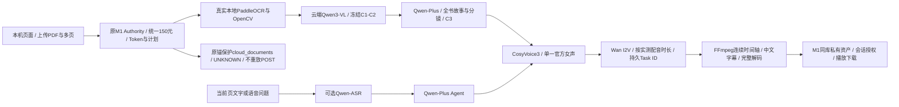
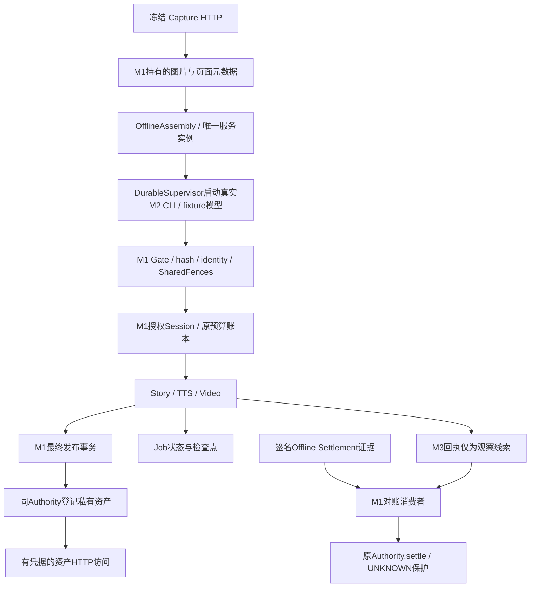

# 统一装配架构

2026-11-18增加[真实模型工作室](REAL_MODEL_STUDIO.md)，独立入口`orchestrator.bailian_app`。
以下保留原离线装配及其冻结接口边界；不把其中的fixture/silent当成真实模型。

新profile复用原Authority的授权、账本、资产BLOB、签名/锚和WindowsTree进程监管。
原`settle`不接受dashscope的fixture账单；实际账务保持UNKNOWN。新元数据没有第二套权限或余额。
输入开始Attempt后不可改排；引用准确的book/job/generation/input_revision和页SHA。详见P5。

原离线装配入口是`orchestrator/local_runtime.py`；不导入测试 rig。
`tools/runtime/m2_entry.py` 只将已提交 M2 包加入隔离解释器，再调用其原 `main`，
不伪造输出、不重建 Worker。真实后端不在冻结 V1 Worker 的许可范围。

M3 输入从 M1 Session 授权读取；授权前不读取本地 OCR/VLM 或捕获图片作为替代。
生成前保留捕获图片 SHA，和 M1 已授权原图核验。Story 在 M1 提交后不改字节。
TTS 只执行一次，后续 Jobs TTS stage 验证；Video 深度解码与元数据检查后发布。
M1 原 `_bound` / grant / token / current / upstream fence 验证和最终复制位于同一
Authority 事务内，防止撤销与发布之间的跨进程窗口。没有第二套权限系统。

私有资产读取前后授权、文件 SHA、Windows 固定句柄继续生效。静态别名先从令牌
选出精确 Asset ID，再核对 job/project/path，最后仍调用同一个 M1 `read`。
同一 Job 多页共享音频名也不发生跨 Attempt 混用。生产多实例/分布式存储未宣称完成。

Job 和页面检查点是本地业务状态，不是资金账本。重启中断状态转 cancelled，不做
自动重投或预算退款。M1 UNKNOWN/SharedFences/durable stage 状态保持原语义。
唯一发布指的是单服务实例、原 current/fences 和同步最终发布；文件复制不是跨文件
事务，异常可留未登记私有碎片，但不会发有效新 URL，不能作为已完成产物访问。

原 MOCK 分支为公共 API 回归保留；旧非 M1 的 M3 演示仅允许显式 local+offline_mock。
这是历史兼容用途，不能在 dev/production 或 blocked 模式绕过 M1。
